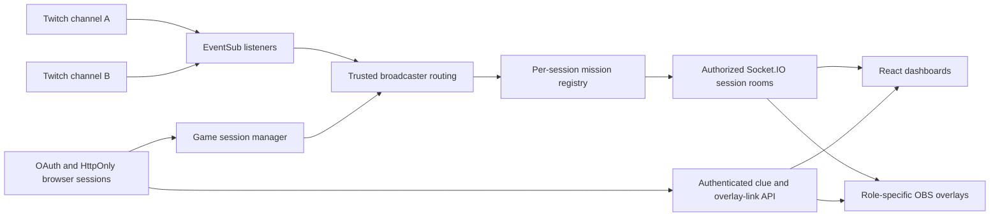

# CollabQuest Live

**Two Streamers. Two Communities. One Shared Mission.**

CollabQuest Live is a local hackathon prototype that turns two Twitch chats into a cooperative puzzle-solving experience.

## Problem and solution

Stream collaborations can leave viewers watching separate experiences rather than working toward a shared outcome. CollabQuest Live gives each streamer a different piece of a puzzle. Their communities communicate, combine clues, and submit an answer through Twitch chat. Both dashboards and OBS overlays update together when the mission is solved.

## Implemented features

- Independent Twitch OAuth login for two accounts, with server-side token storage and refresh.
- Authenticated session creation and invite-based joining; one participant per role A/B.
- Independent in-memory mission instances per collaborative session.
- Role-specific clues in authenticated dashboards and read-only OBS overlays.
- Twitch EventSub chat reception, reconnect handling, and safe `!answer` parsing.
- Socket.IO synchronization with authorized session rooms and sanitized mission state.
- Expiring, revocable overlay credentials that do not require OBS to share browser login cookies.
- A public legacy dashboard/overlay path for the original single-streamer workflow.

## The Locked Vault

Role A receives the symbol order: **△ ○ □ ☆**. Role B receives the mapping: **△=4, ○=7, □=2, ☆=9**. Together these produce the demo answer. Sending `!answer 4729` in either connected participant's Twitch channel completes that session's mission. Wrong or malformed answers do not complete it; duplicate correct submissions are ignored. Progress is binary: ACTIVE / 0% or UNLOCKED / 100%.

These puzzle details are documented for demo reproducibility; the answer is not a security credential. Runtime public mission payloads contain only ID, title and status. The demo puzzle is fixed, so this source repository is not intended to hide its solution from readers.

## Stack and architecture

The React + Vite frontend uses JavaScript JSX. The Node.js 24 + Express 5 backend owns authentication, sessions, mission state and authorization. Socket.IO delivers real-time state. Twitch OAuth, the Helix Twitch API and EventSub provide identity and chat events.



Key modules: `backend/server.js` (wiring/OAuth), `chat.js` (EventSub lifecycle), `game-session.js`, `session-chat-router.js`, `mission-engine.js`, `session-mission-registry.js`, `session-api.js`, `browser-session.js`, `overlay-access.js`, and `realtime.js`. The frontend entry point selects the dashboard, public `/overlay`, or credential-authorized `/streamer-overlay` page.

## Install on Windows

Install Node.js 24 with npm, Chrome, and OBS Studio. From the project folder, install the lockfile-defined dependencies:

```powershell
Set-Location 'C:\Users\THANGA PRAKASH\CollabQuest-Live\backend'
npm ci
Set-Location 'C:\Users\THANGA PRAKASH\CollabQuest-Live\frontend'
npm ci
```

There is no root npm startup script. No frontend secrets are required.

## Twitch developer application setup

Register an application in the [Twitch developer console](https://dev.twitch.tv/console/apps), following [Twitch's registration instructions](https://dev.twitch.tv/docs/authentication/register-app/). The developer account needs verified email and two-factor authentication. Add this exact OAuth redirect URL:

```text
http://localhost:3000/auth/twitch/callback
```

Obtain the application's client ID and client secret privately. This backend uses the [Authorization Code Grant flow](https://dev.twitch.tv/docs/authentication/getting-tokens-oauth/#authorization-code-grant-flow). It requests only `user:read:chat`, exchanges the code server-side, and looks up the authenticated user through Helix Users. Each listener subscribes to `channel.chat.message` for its authenticated user's own channel.

The local backend reads these required variable names from `backend/.env` at startup. Configure them privately; never commit that file or paste its contents into a demo:

| Variable | Purpose |
| --- | --- |
| `TWITCH_CLIENT_ID` | Registered application client ID |
| `TWITCH_CLIENT_SECRET` | Server-only application secret |
| `TWITCH_REDIRECT_URI` | Exact callback URL above |
| `SOCKET_IO_ORIGINS` (optional) | Comma-separated exact trusted origins; defaults to `http://localhost:5173` |
| `NODE_ENV` (optional) | Production enables Secure cookies; localhost demo uses HTTP development settings |

Do not switch to production mode on plain HTTP localhost. Production hosting requires further security and operational work, not just a variable change.

## Start the application

Backend terminal:

```powershell
Set-Location 'C:\Users\THANGA PRAKASH\CollabQuest-Live\backend'
node server.js
```

Frontend terminal:

```powershell
Set-Location 'C:\Users\THANGA PRAKASH\CollabQuest-Live\frontend'
npm run dev
```

Open `http://localhost:5173`. Use `localhost` consistently, not `127.0.0.1`. Keep ports 3000 and 5173 available. After backend code changes, restart the backend; a stale process can return 404 for newer routes. Restarting discards tokens, browser sessions, collaborative sessions and overlay credentials.

## Two-account walkthrough

1. Use separate Chrome profiles, or normal Chrome and Incognito. Connect one Twitch account in each. After OAuth completes, return to the frontend in the same browser profile.
2. Account A creates a session. Privately share the invite with Account B, which joins it. Confirm the session is ACTIVE.
3. Confirm A sees only the symbol-order clue and B only the mapping. An authenticated clue is still visible to viewers if its dashboard is screen-shared.
4. From either account's Twitch channel chat, send a wrong answer to show rejection, then `!answer 4729` to solve it. Both dashboards should show UNLOCKED / 100%.
5. Reload a dashboard to verify it receives the current mission state. To rehearse a fresh mission, leave and recreate/join a session using existing controls, then generate fresh overlay links.

## OBS Browser Sources

For each active participant, click **Copy OBS Overlay Link** in their own dashboard. If the clipboard is blocked, select the temporary read-only field and press Ctrl+C. Paste the entire private link into a separate OBS Browser Source: width **1920**, height **1080**, Local file unchecked. The background is transparent. Configure source URLs off camera.

The initial generation replaces the participant's previous link; repeat copying in the mounted component reuses it. **Revoke OBS Link** invalidates it. Links expire after eight hours and are revoked when membership becomes invalid; server restart also invalidates them. Anyone possessing a link can view that role's stream-visible clue until expiration/revocation. Never publish URLs, source properties, scene exports, or recordings showing them.

Both sources display their own clue and the shared mission status. Connection loss clears the private clue once detected. The existing public `http://localhost:5173/overlay` remains available. See [OBS-OVERLAYS.md](OBS-OVERLAYS.md) for more verification steps.

## Validation

```powershell
Set-Location 'C:\Users\THANGA PRAKASH\CollabQuest-Live\backend'
Get-ChildItem *.js | ForEach-Object { node --check $_.FullName }
Set-Location 'C:\Users\THANGA PRAKASH\CollabQuest-Live\frontend'
npm run build
```

The 10 automated backend test files were intentionally removed before publication. Historically, all 45 tests passed; npm test no longer provides that coverage. Current checks passed for all 10 production modules: syntax, 24 resolved imports, and isolated startup with HTTP 200 (environment-file loading disabled). A successful frontend build is a compilation check, not an OBS visual test. The maintainer verified the real two-account Twitch-to-dashboard-to-OBS flow.

## Security and limitations

This is a localhost prototype with one demo mission and in-memory state. It is not a deployed production multi-user service. Browser sessions use HttpOnly, SameSite=Lax cookies (Secure in production). State validation protects OAuth; authenticated mutation routes enforce trusted Origin and CSRF headers. Overlay capabilities are separate, hashed in server memory, role-scoped and read-only. Private responses use no-store; overlay pages use no-referrer and no third-party resources.

Local URLs assume frontend, backend and OBS run on the same computer. Persistent storage, broader abuse controls, operational monitoring, comprehensive token validation/revocation handling and remote HTTPS deployment remain future work. Dependency vulnerability scanning and a full production security review are not covered by these validation checks.

## Codex collaboration and future work

Codex helped turn incremental prompts into modular OAuth, EventSub, mission, session, real-time and overlay code; added mocked tests; investigated keepalive and clipboard issues; and prepared documentation. The developer tested the integrations with two real Twitch accounts and OBS, providing feedback between iterations. The demo should include brief footage of the actual development thread, not a recreated conversation.

Future improvements include more missions, persistent session storage, production hosting and security hardening, stronger reconnect/resume UX, and expanded accessibility/testing. These are roadmap items, not current features.

Submission narrative: [SUBMISSION.md](SUBMISSION.md). Recording plan: [DEMO-CHECKLIST.md](DEMO-CHECKLIST.md).
